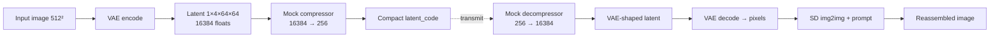

# MORPHOS

**Generative Compression Codec** — RedBot / IMAGE_8 workflow.

Ship a tiny latent vector; reassemble a high-fidelity image with a frozen diffusion prior.

> RedBot research scaffold. Extreme rate reduction via a learned (mock) bottleneck, then generative reconstruction.

Also in this repo: **[Morphogen v2](./morphogen-v2/)** — the living RD audiovisual instrument rebuilt **without WebGL** (CPU Gray–Scott + Canvas 2D). See [MORPHOS and Morphogen](./docs/MORPHOS-AND-MORPHOGEN.md) and the [red-team brief](./docs/morphogen-redteam/MASTER-BRIEF.md).

## Architecture (IMAGE_8)



1. **Encode** — Image → VAE latent `(1, 4, 64, 64)` → mock extreme compression → compact vector (default **256** floats ≈ 1 KB FP32).
2. **Transmit** — Compact numeric code (not an RD / residual-pattern bitstream).
3. **Decode** — Expand vector → VAE-shaped latent → VAE pixels → Stable Diffusion **img2img** (prompt-guided generative reassembly).

### Design notes

| Piece | Status | Notes |
|-------|--------|-------|
| SD 1.5 VAE + UNet | Real (pretrained) | Diffusers `runwayml/stable-diffusion-v1-5` |
| Compression / decompression MLPs | **Untrained mocks** | Shape demo only — train end-to-end in production |
| Decode path | VAE → img2img | Avoids incorrect `latents=` text2img shortcuts |
| Rate–distortion | Illustrative only | `rate_stats()` FP32 + `quantized_rate_stats()` / STE (+ **`LearnedQuantAffine`**) + factorized Laplace + **categorical** `-log2 p(index)` + **tabled rANS** + **self-describing ANS pack** + **hyperprior pack** + **hierarchical hyperprior rate** (+ **learned prior on z_h**) + **hier ANS pack (MRPH v3)** + **hier+prior ANS pack (MRPH v4)** + **peek/describe/dispatch**; see [ENTROPY-CODING-NOTES.md](./docs/ENTROPY-CODING-NOTES.md) |
| Bottleneck train sketch | CPU dry-run + STE + learned scales + entropy + categorical + hyper-rate (+ learned-hyper-prior) + ANS check/pack/hyper/hier/hier-prior | [`bottleneck_train_sketch.py`](./bottleneck_train_sketch.py) (`--ste-quant`, `--learned-quant-scales`, `--entropy-rate`, `--categorical-rate`, `--hyper-rate`, `--learned-hyper-prior`, `--ans-check`, `--ans-pack`, `--ans-hyper`, `--ans-hyper-hier`, `--ans-hyper-hier-prior`) + [docs/TRAINING-SKETCH.md](./docs/TRAINING-SKETCH.md) |

Default illustrative rate at 512²: **256×4 B = 1024 B** → **~0.031 bpp** before generative decode (not a trained RD curve). Uniform 8-bit symbols on the same dim sketch **~0.0078 bpp**. Factorized Laplace (`--entropy-rate`) and categorical-over-STE-indices (`--categorical-rate`) are differentiable rate proxies; `--ans-check` adds a tabled rANS bitstream round-trip under those categorical PMFs, `--ans-pack` wraps it with frequency side-info so decode needs no live model, and `--ans-hyper` replaces those tables with a quantized hyperlatent (`HyperpriorTableModel`). `--ans-hyper-hier` packs under the hierarchical analysis→synthesis path (MRPH v3). `--hyper-rate` trains that bridge under a hierarchical R(z_h)+R(indices|z_hat) objective; `--learned-hyper-prior` replaces uniform side-info with a categorical prior on quantized z_h; `--ans-hyper-hier-prior` (MRPH v4) ANS-codes those hyper indices under the learned prior instead of raw H×u8. `--learned-quant-scales` adapts per-dim STE ranges.

## Quick start (codec)

```bash
python -m venv .venv && source .venv/bin/activate
pip install -r requirements.txt
python generative_codec.py --out-dir ./outputs
# or: ./scripts/run_demo.sh
```

GPU (`cuda`) is strongly preferred. CPU falls back to FP32 and will be slow. First run downloads model weights from Hugging Face.

### Shape-only tests (no model download)

```bash
pip install pytest torch torchvision Pillow requests
PYTHONPATH=. pytest tests/ -q
```

### Bottleneck train sketch (no model download)

```bash
PYTHONPATH=. python bottleneck_train_sketch.py --steps 8
PYTHONPATH=. python bottleneck_train_sketch.py --steps 8 --ste-quant --quant-levels 256
PYTHONPATH=. python bottleneck_train_sketch.py --steps 8 --learned-quant-scales
PYTHONPATH=. python bottleneck_train_sketch.py --steps 8 --entropy-rate
PYTHONPATH=. python bottleneck_train_sketch.py --steps 8 --categorical-rate
PYTHONPATH=. python bottleneck_train_sketch.py --steps 8 --ans-check
PYTHONPATH=. python bottleneck_train_sketch.py --steps 8 --ans-pack
PYTHONPATH=. python bottleneck_train_sketch.py --steps 8 --ans-hyper
PYTHONPATH=. python bottleneck_train_sketch.py --steps 8 --ans-hyper-hier --hyper-dim 16
PYTHONPATH=. python bottleneck_train_sketch.py --steps 8 --hyper-rate --hyper-dim 16
PYTHONPATH=. python bottleneck_train_sketch.py --steps 8 --hyper-rate --learned-hyper-prior --hyper-dim 16
PYTHONPATH=. python bottleneck_train_sketch.py --steps 8 --hyper-rate --learned-hyper-prior --ans-hyper-hier-prior --hyper-dim 16
PYTHONPATH=. pytest tests/test_train_sketch.py -q
```

See [docs/TRAINING-SKETCH.md](./docs/TRAINING-SKETCH.md) for the frozen-prior training plan and [docs/ENTROPY-CODING-NOTES.md](./docs/ENTROPY-CODING-NOTES.md) for the rate ladder beyond FP32.

## Morphogen v2 (no WebGL)

```bash
cd morphogen-v2 && npm install && npm run dev
```

Open `http://127.0.0.1:5173` → ENTER → drag to seed colonies (**M** mutes the Hum, **L** locks a loop). `npm run check:nowebgl` must stay clean.

## CLI (codec)

| Flag | Default | Meaning |
|------|---------|---------|
| `--image` | HF sample URL | Local path or URL |
| `--prompt` | flower photo prompt | img2img guidance text |
| `--steps` | 30 | Diffusion steps |
| `--seed` | 42 | Reproducibility |
| `--out-dir` | `.` | Writes `original_input.png` + `generative_reassembled_output.png` |
| `--model-id` | `runwayml/stable-diffusion-v1-5` | Diffusers model |
| `--compact-dim` | 256 | Mock compact code length (floats); drives `rate_stats()` |
| `--quant-levels` | 256 | Uniform codebook size for `quantized_rate_stats` print |

## Known limitations

- Mock Linear nets mean **identity is not preserved**; outputs are generative / prompt-biased.
- Full encode→decode needs CUDA + multi-GB disk for weights — not suitable for GPU-less CI.
- Safety checker disabled in the demo pipeline for research friction; re-enable for product use.

## Project status

MORPHOS under RedBot ops. Daily commits refine architecture, docs, and eval harnesses. See [STATUS.md](STATUS.md) for the dated cadence log.

### Changelog

- **2026-10-24 (09:15 ET)** — Morphogen v2 TD command tally: when a TouchDesigner cue "did nothing" there was no way to tell whether the browser refused the frame, rate-limited it, or applied it and the handler failed, because every drop was silent by design. `TdClient` now sorts every authed TD → app frame into exactly one bucket (applied / pings / refused / paced, plus a handler-error count) via `commandStats()`, reset on each fresh ack; `describeCommandStats` in `src/sync/tdCommand.ts` renders it as one line (`TD cmds: 3 applied · 1 ping · 2 paced`) and the `?debug=1` snapshot now includes it as `tdCommands`. Counts only, no ids, payloads or tokens. Dropping behaviour is unchanged. New `tests/tdCommandStats.test.mjs` (3 tests, `npm test` 118 pass); TD pytest 53 pass.
- **2026-10-23 (09:20 ET)** — Morphogen v2 TD ↔ browser contract fixture: the browser command parser (`src/sync/tdCommand.ts`) and the TouchDesigner sender (`td/morphogen_sync_commands.py`) are hand-written twins, and only the byte cap and preset list were cross-checked, so a drift in id normalisation, JSON formatting or the rate bucket would only show up as TD cues silently dropped mid-show. New golden file `morphogen-v2/tests/fixtures/td-commands.v1.json` is read by both a new node suite (`tests/tdContract.test.mjs`, 5 tests) and a new pytest suite (`tests/test_td_sync_contract.py`, 17 cases): TD builders must emit the exact bytes the browser parses, both sides reject the same junk, the browser pong is matched by `RttTracker`, and `CommandPacer` / `createCommandGate` give identical verdicts for one clock script (burst, 100 ms refill, backwards clock, long idle). No runtime code changed. `npm test` 115 pass; TD pytest 53 pass.
- **2026-10-22 (09:30 ET)** — Morphogen v2 TD-side command helper: yesterday's browser change let TouchDesigner send `preset` / `ping`, but the TD callbacks had no way to build those frames, and a returning `pong` was treated as telemetry, which cleared `morphogen_table` on every ping. New `morphogen-v2/td/morphogen_sync_commands.py` builds commands with the browser's exact rules (trimmed lower-case ids, known-preset check, 512-byte cap), paces them with the same 10/s, burst-5 token bucket so none get silently dropped, and measures round-trip time from pongs that echo a ping this TD actually sent. `morphogen_sync_callbacks.py` gains `send_preset(dat, id)` / `send_ping(dat)` (authed clients only), writes RTT to an optional `morphogen_rtt` Table DAT, and only lets real telemetry frames touch the tables. 9 new pytest cases in `tests/test_td_sync_commands.py`, including drift checks that the preset list and byte cap still match the TypeScript; [STATUS.md](STATUS.md).
- **2026-10-21 (09:10 ET)** — Morphogen v2 TD → app control plane: REBUILD-SPEC reserved the socket's TD → app direction, but `TdClient` silently dropped every frame after the handshake, so TouchDesigner had no way to cue the browser. New `morphogen-v2/src/sync/tdCommand.ts` parses `{v:1, cmd:"preset", id}` (switches the Field preset through the same cycler as the button, so unknown ids do nothing) and `{v:1, cmd:"ping", t}` (the client answers with a `pong` for latency checks). Commands only count after TD acked the authed hello, are capped at 512 bytes, rate-limited by a token bucket (10/s, burst 5) whose clock can't be fooled backwards, and a throwing handler can't drop the session; `setParams` / `freeze` stay refused for now. 8 new tests in `tdCommand.test.mjs` and `tdClient.test.mjs` (110 total). The scheduled 2026-10-19 and 2026-10-20 runs did not land commits; [STATUS.md](STATUS.md).
- **2026-10-18 (09:09 ET)** — Morphogen v2 preset back-stepping: the Field panel could only move forward, so getting from Coral back to Holes meant clicking through seven presets mid-performance. Shift-clicking **Field** now steps back one preset (`presetStepDir` in `src/ui/field.ts`; `mountPanelStubs` forwards the click's Shift state to `onPanel`), and the keyboard gets **]** = next / **[** = previous in `src/ui/keys.ts`, sharing one `stepPreset` path in `main.ts` so the status line is identical. Auto-repeat is ignored (holding **]** moves one preset, not ten) and the usual chord / text-field guards apply; on AltGr layouts the bracket keys arrive as Ctrl+Alt and are rejected, so Shift-click is the fallback there. `aria-keyshortcuts` and the button title advertise both. 4 new tests across `keys`, `panels` and `field` (102 total); [STATUS.md](STATUS.md).
- **2026-10-17 (09:20 ET)** — Morphogen v2 Field presets: the **Field** panel button was a stub that only printed `panel field (stub)`, so the 10 v7 presets in the kernel table (a REBUILD-SPEC parity item) were unreachable from the UI. New `src/ui/field.ts` cycles them in a fixed `PRESET_ORDER` (Mitosis → … → Skate, wrapping), applies each through `GrayScott.setParams` so `sanitizeParams` still guards every value, and shows the preset name, position and feed / kill on the status line; `?preset=<id>` picks the boot preset (unknown ids fall back to Mitosis). The cycler only commits a new label after the kernel accepted the params. 7 new tests in `morphogen-v2/tests/field.test.mjs` (98 total); [STATUS.md](STATUS.md).
- **2026-10-16 (09:25 ET)** — Morphogen v2 HUD: new `src/ui/hud.ts` replaces the inline per-frame HUD string in `main.ts`. Numbers go through `formatStat`, so a NaN / Infinity stat reads `—` and a tiny negative no longer flickers as `-0.000`; the lock count is clamped to a non-negative integer. `createHudWriter` writes the footer at most 10 times a second and only when the text changed (it was rewritten on every frame, 60–240 times a second, forcing a footer layout each time); Lock loop and Reset `invalidate()` it so the new count shows immediately. 8 new tests in `morphogen-v2/tests/hud.test.mjs` (91 total); [STATUS.md](STATUS.md).
- **2026-10-15 (09:20 ET)** — Morphogen v2 frame loop: new `src/app/loop.ts` replaces the fixed `STEPS = 2` per `requestAnimationFrame` in `main.ts`, which tied sim speed to the display (a 120 Hz screen ran the field twice as fast, a throttled 30 Hz one at half speed). `paceSteps` is a fixed-timestep accumulator at `SIM_HZ` = 120 steps/s (unchanged look at 60 Hz), capped at 4 steps per frame with the backlog dropped so a tab return or slow device can't burst; `createFrameLoop` keeps a single rAF chain; `singleFlightUnlock` merges overlapping ENTER / canvas-press unlocks and turns a rejecting `AudioContext.resume()` into a silent start instead of a stuck gate. 7 new tests in `morphogen-v2/tests/loop.test.mjs` (83 total); [STATUS.md](STATUS.md).
- **2026-10-14 (09:12 ET)** — Morphogen v2 pointer seeding: new `src/ui/pointer.ts` replaces the inline click/drag code in `main.ts`. `pointerToField` rejects zero-size rects and non-finite input (previously a collapsed canvas divided by 0 and NaN reached `sim.seed`); `strokePoints` interpolates fast drags into a continuous stroke (spacing 0.01, max 24 seeds per move); only the primary pointer's main button paints, one pointer at a time; `lostpointercapture` / `pointercancel` end the stroke so painting can't stick on. 7 new tests in `morphogen-v2/tests/pointer.test.mjs` (76 total). Also verified the 2026-10-13 keyboard-shortcut push: `npm test`, `tsc --noEmit`, `vite build` and `check:nowebgl` all clean; [STATUS.md](STATUS.md).
- **2026-10-13 (09:40 ET)** — Morphogen v2 keyboard shortcuts: new `src/ui/keys.ts` (**M** = mute Hum, **L** = lock loop; Reset stays click-only). Pure `resolveKeyAction` ignores Ctrl / Cmd / Alt chords, auto-repeat, IME composition, already-handled events and text-entry targets (`isTextEntryTarget`: text-like inputs, textarea, select, contentEditable); `mountKeyboardShortcuts` only calls `preventDefault()` for keys it handled. `main.ts` shares one code path per action between buttons and keys; `aria-keyshortcuts` on `#muteHum` / `#lockLoop`; 7 new tests in `morphogen-v2/tests/keys.test.mjs`. Pushed through the GitHub API this pass (build box offline), so `npm test` / `tsc` were not run yet; the next pass verifies and logs results in [STATUS.md](STATUS.md).
- **2026-10-12 (09:35 ET)** — Morphogen v2 panel input hygiene + Sound mute toggle: `resolvePanelAction` routes clicks on a button's child elements, ignores unknown `data-panel` ids and disabled controls; Lock-loop cap and Reset-confirm rules moved out of `main.ts` into pure `nextLockCount` / `resetNeedsConfirm`; new **Hum on / Hum muted** button (`#muteHum`, `aria-pressed`) wired to `HumEngine.setMuted`; first panel tests (`morphogen-v2/tests/panels.test.mjs`, 9 new, 62 total); [STATUS.md](STATUS.md).
- **2026-10-11 (09:20 ET)** — Morphogen v2 Canvas 2D renderer hardening: precomputed 256-step `PALETTE_LUT` (one lookup per pixel instead of three `Math.floor`s), NaN-safe `fieldTone` (bad cells render as background), bounded `fieldToRGBA` that never reads past short buffers, `safeDim` resize guard; first renderer tests (`morphogen-v2/tests/canvas2d.test.mjs`, 7 new, 53 total); [STATUS.md](STATUS.md).
- **2026-10-10 (09:10 ET)** — Morphogen v2 Hum audio safety: NaN-safe `energyToDetune`, `modulate()` only schedules on a real detune change (no per-frame automation pile-up), mute remembered across unlock, anchored gain ramps capped at `HUM_LEVEL_ON`, `dispose()` disconnects every node incl. the compressor; first audio tests (`morphogen-v2/tests/hum.test.mjs`, 8 new, 46 total); [STATUS.md](STATUS.md).
- **2026-10-09 (09:30 ET)** — Morphogen v2 Gray–Scott kernel guards: `sanitizeParams` / `PARAM_LIMITS` for every param update (new `setParams`), `step(dt)` clamped to `maxStableDt` (D·dt ≤ 1/4) with NaN/≤0 dt a no-op, NaN cells scrubbed to 0 instead of blacking out the field; first kernel tests (`morphogen-v2/tests/grayScott.test.mjs`, 9 new, 38 total); [STATUS.md](STATUS.md).
- **2026-10-08 (09:00 ET)** — Morphogen v2 Sync URL hygiene: `sanitizeTdUrl` (ws/wss only, no credentials or control chars, canonical form), host allowlist `127.0.0.1` / `localhost` / `*.local` with a per-session confirm for other wss hosts (cleartext to remote hosts refused), schema-checked persisted Sync settings that never store the secret (`loadSyncSettings` / `saveSyncSettings`), grid default off off-loopback; 12 new tests (`morphogen-v2/tests/syncUrl.test.mjs`, 29 total); [SYNC-AUTH.md](docs/morphogen-redteam/SYNC-AUTH.md#sync-url-allowlist--persisted-settings-added-2026-10-08); [STATUS.md](STATUS.md).
- **2026-10-07 (09:00 ET)** — Morphogen v2 Sync status chip: live footer read-out of the Sync state with a retry countdown (`describeTdStatus`, `mountSyncStatus`) and a **Retry now** button (`TdClient.retryNow()` skips the wait but keeps the 8-try budget; no-op after auth failures); `snapshot()`; 6 new tests (`morphogen-v2/tests/syncStatus.test.mjs`, 17 total); [SYNC-AUTH.md](docs/morphogen-redteam/SYNC-AUTH.md#sync-status-chip-added-2026-10-07); [STATUS.md](STATUS.md).
- **2026-10-06 (09:00 ET)** — Morphogen v2 Sync reconnect backoff: transient drops retry with capped exponential backoff + equal jitter (`reconnectDelayMs`, 8-try budget, `reconnecting` status); auth rejects / ack timeouts stay terminal; first committed client tests (`morphogen-v2/tests/tdClient.test.mjs`, `npm test`); [SYNC-AUTH.md](docs/morphogen-redteam/SYNC-AUTH.md#reconnect-backoff-added-2026-10-06); [STATUS.md](STATUS.md).
- **2026-10-05 (09:00 ET)** — Morphogen v2 Sync auth hardening: hello→ack handshake in `tdClient.ts` (no telemetry before TD acks; 2 s timeout; token checks), reference TD gate `morphogen-v2/td/` + `tests/test_td_sync_auth.py`; [SYNC-AUTH.md](docs/morphogen-redteam/SYNC-AUTH.md); [STATUS.md](STATUS.md).
- **2026-10-04 (09:00 ET)** — MRPH header describe (`mrph_describe_header`) + train-sketch pack peek/dispatch wire-up; truncated-header tests; entropy/training docs; [STATUS.md](STATUS.md).
- **2026-10-03 (09:00 ET)** — MRPH header peek + version-dispatch unpack (`mrph_peek_header` / `mrph_unpack_indices`); tests + entropy/training docs; [STATUS.md](STATUS.md).
- **2026-10-02 (09:00 ET)** — MRPH v1–v4 flag/wire guide (`mrph_pack_version_guide`), v4 unpack edge tests + `sideinfo_saving_vs_v3_raw` in pack stats; entropy/training docs; [STATUS.md](STATUS.md).
- **2026-10-01 (09:00 ET)** — ANS-coded hyper indices under learned prior (MRPH v4 / `--ans-hyper-hier-prior`); tests + entropy/training docs; [STATUS.md](STATUS.md).
- **2026-09-30 (09:00 ET)** — Learned categorical prior on quantized z_h (`hyper_prior=` / `--learned-hyper-prior`) for hierarchical hyperprior rate; tests + entropy/training docs; [STATUS.md](STATUS.md).
- **2026-09-29 (09:00 ET)** — Hierarchical hyperprior ANS pack (MRPH v3 / `--ans-hyper-hier`); tests + entropy/training docs; [STATUS.md](STATUS.md).
- **2026-09-28 (09:00 ET)** — Hierarchical hyperprior rate (`hyperprior_hierarchical_rate_bpp` / `--hyper-rate`); trains `HyperpriorTableModel` jointly; tests + entropy/training docs; [STATUS.md](STATUS.md).
- **2026-09-27 (09:00 ET)** — Hyperprior table side-info pack (`HyperpriorTableModel` / `--ans-hyper`) replacing raw freq tables; tests + entropy/training docs; [STATUS.md](STATUS.md).
- **2026-09-26 (09:00 ET)** — Self-describing ANS pack (`ans_pack_indices` / `--ans-pack`) with freq side-info; CLI `--ans-check` wired; tests + entropy/training docs; [STATUS.md](STATUS.md).
- **2026-09-25 (09:00 ET)** — Tabled rANS encode/decode over categorical STE indices (`ans_encode_indices` / `--ans-check`), tests + entropy/training docs; [STATUS.md](STATUS.md).
- **2026-09-24 (09:00 ET)** — Discrete categorical prior over STE indices (`CategoricalEntropyModel` / `categorical_rate_stats`), train-sketch `--categorical-rate`, tests + entropy/training docs; [STATUS.md](STATUS.md).
- **2026-09-23 (09:00 ET)** — Learned per-dim quant scales (`LearnedQuantAffine`), train-sketch `--learned-quant-scales`, tests + entropy/training docs; [STATUS.md](STATUS.md).
- **2026-09-22 (09:00 ET)** — Factorized Laplace entropy model (`FactorizedEntropyModel` / `factorized_rate_stats`), train-sketch `--entropy-rate` (+ optional `--entropy-hinge`), tests + entropy/training docs; [STATUS.md](STATUS.md).
- **2026-09-21 (09:00 ET)** — STE uniform quant (`straight_through_quantize`) wired into bottleneck train sketch (`--ste-quant` / `--quant-levels`), quantized rate hinge, tests + entropy/training docs; [STATUS.md](STATUS.md) (includes 2026-09-20 gap note).
- **2026-09-19 (09:00 ET)** — Entropy/coding notes (`docs/ENTROPY-CODING-NOTES.md`), `quantize_uniform` / `quantized_rate_stats`, CLI `--quant-levels`, expanded shape tests; [STATUS.md](STATUS.md) cadence entry.
- **2026-09-18 (09:00 ET)** — Bottleneck training-loop sketch (`bottleneck_train_sketch.py`), [docs/TRAINING-SKETCH.md](./docs/TRAINING-SKETCH.md), `tests/test_train_sketch.py`; [STATUS.md](STATUS.md) cadence entry.
- **2026-09-17 (09:00 ET)** — `rate_stats()` / `describe_rate()`, CLI `--compact-dim`, encode-time bpp print, expanded shape tests; [STATUS.md](STATUS.md) cadence entry.
- **2026-09-17 (earlier)** — Morphogen v2 (no WebGL) scaffold + red-team brief; root README links.
- **2026-09-17** — Initial IMAGE_8 generative compression codec scaffold.

## License

MIT — see [LICENSE](LICENSE).
