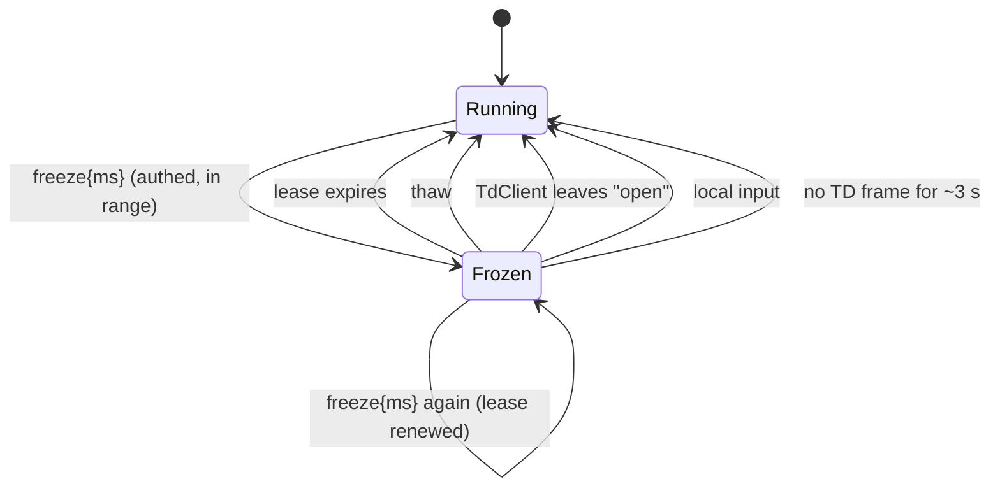

# Morphogen v2 — `freeze` limits review (TD → app)

_Design review, added 2026-11-07. Status: **still refused.** `parseTdCommand`
returns `null` for `{v:1, cmd:"freeze"}` today, and
`tests/tdCommandsDoc.test.mjs` asserts that. This page answers the question the
`src/sync/tdCommand.ts` header has carried since 2026-10-21 — "who un-freezes
the sim if TD drops?" — so the next implementation pass starts from agreed
rules instead of re-deriving them. No code changed with this note._

_Progress 2026-11-08: step 2's pure helper has landed on its own —
`morphogen-v2/src/sync/freezeLease.ts` (`createFreezeLease`, `isValidFreezeMs`,
`MIN_FREEZE_MS` 250 / `MAX_FREEZE_MS` 10 000 / `FREEZE_SILENCE_MS` 3 000,
`describeFreeze` / `describeThaw`) with 12 node tests in
`tests/freezeLease.test.mjs`. It is not imported by `main.ts` and the parser
still refuses `freeze`, so runtime behaviour is unchanged. Still to do: the
fixture rows (step 1), `parseTdCommand` cases and `main.ts` / `TdClient`
wiring (rest of step 2), the TD twin (step 3) and the integration tests in
step 4._

_Progress 2026-11-09: step 3's pure builders have landed —
`td/morphogen_sync_commands.py` has `MIN_FREEZE_MS` / `MAX_FREEZE_MS` (pinned
to `freezeLease.ts` by a pytest), `make_freeze_command(ms)` and
`make_thaw_command()`, with the same refuse-not-clamp rules. `send_freeze` /
`send_thaw` and the `freeze` row in `morphogen_cmds` wait until the browser
accepts the frame; `test_no_freeze_sender_until_the_browser_accepts_it`
enforces that order and should be deleted in that change._

_Progress 2026-11-10: step 1 is staged in the shared fixture as a separate
`freeze_staged` block in `tests/fixtures/td-commands.v1.json` — `freeze_ms_range`
(250 / 10 000), five TD-built frames (`freeze` 250 / 1500 / 2000.0→2000 /
10 000 and a bare `thaw`), ten builder rejects, eight browser refusals and the
`ms` values the lease must refuse. Both suites read it: pytest checks TD's
bytes, rejects and limits; `tdContract.test.mjs` checks the range against
`freezeLease.ts` and that **every** staged frame, well-formed or not, is still
refused by `parseTdCommand`. That last test is the browser half of the
step-order guard. Lifting the refusal = move the `built` rows (with a `parsed`
shape) into the top-level `built` list, drop the plain `freeze` row from
`browser_refuses`, delete both guard tests — in one change, alongside step 2's
wiring and step 4's tests._

_Progress 2026-11-11: step 4's behaviour tests now exist, against a pure
binding rather than `main.ts` — `morphogen-v2/src/sync/freezeControl.ts`
(`createFreezeControl({halt, resume, onThaw})`) owns *who restarts the loop and
when*: `freeze(ms, now)` halts once (renewals don't re-halt; refused frames
and frames before an authed `open` touch nothing), `thaw()`, `status(s)` thaws
synchronously on leaving `open` — TdClient fires `onStatus('reconnecting')`
before it arms the backoff timer, so the field is running before any retry —
and on a fresh `open`, `local()` and `tick(now, lastFrameAt)` for expiry /
silence. It only resumes a loop it halted itself. 14 cases in
`tests/freezeControl.test.mjs`. Still unwired: the parser refuses `freeze`, and
lifting that remains the one reviewed change described above (parser cases,
`main.ts` calls into this binding, `send_freeze` / `send_thaw`, fixture move,
`TD-COMMANDS.md`)._

_Progress 2026-11-12: wiring correction. The 11-11 note planned
`halt` / `resume` = `loop.stop()` / `loop.start()` with "a per-frame `tick`" —
those two can't both be true: a stopped loop has no frames, so nothing would
call `tick` and an expired or silent freeze would never end. `createStepHold()`
in `src/app/loop.ts` is the replacement: `halt` / `resume` = `hold.hold` /
`hold.release`, and `onFrame` runs `steps = hold.gate(steps)` after
`freeze.tick(now, td.commandStats().lastAt)`. The loop keeps running, so the HUD, Hum
modulation and the tick stay alive; `paceSteps` keeps consuming time while
held, so a thaw never bursts; `release` never calls `loop.start()`. Six cases
in `tests/stepHold.test.mjs` drive the real loop + real binding with a fake
rAF. One known gap, accepted: `onFrame` returns early while
`document.hidden`, and browsers pause rAF in hidden tabs anyway, so a freeze
that expires in a background tab is ended on the first frame after the tab
returns. Still refused; lifting it is the same one change as before._

_Progress 2026-11-13: clock correction. The 11-12 wiring line fed onFrame's
rAF `now` (ms since page load) to `freeze.tick`, but `TdClient` stamps
`commandStats().lastAt` with `Date.now` (epoch ms). With the lease started on
either clock and checked on the other, `left()` clamps elapsed at 0 (never
expires) and the newest-heard time sits in the future (silence never fires).
Fix: the wiring uses `Date.now()` for both `freeze.freeze` and `freeze.tick`
(header in `src/app/loop.ts` updated), and `freezeLease.check` gained a seat
belt — a `now` more than the silence window behind the lease start thaws with
`silence`, and a `lastFrameAt` ahead of `now` is ignored. Four new node tests;
three of them fail with the guard removed. Still refused._

## Why `freeze` is different from `preset` and `setParams`

`preset` and `setParams` are **idempotent and self-healing**: if TD vanishes
mid-show, the Field keeps animating with the last numbers it was given, and the
performer can still move the sliders or step presets locally. Nothing is stuck.

`freeze` is the first command whose effect is **a missing thing** (no kernel
steps). If TD sends `freeze` and then the link dies, the browser shows a still
image indefinitely, and from the audience's side that is indistinguishable from
a crashed tab. So the review is mostly about the exits, not the entry.

## What the code already gives us (checked on `main` this run)

| Fact | Where | Why it matters for `freeze` |
| --- | --- | --- |
| A dropped authed socket goes `open` → `reconnecting` in `ws.onclose`, then retries with capped backoff (`RECONNECT_BASE_MS` 500, `RECONNECT_MAX_MS` 15 000, `RECONNECT_MAX_ATTEMPTS` 8). | `src/sync/tdClient.ts` | There is a single, reliable place to notice "TD is gone": the status leaving `open`. Reconnect can take tens of seconds, or give up entirely. |
| Every fresh ack resets the command gate, the tally and `tdRtt()`. | `tdClient.ts` (`onmessage` ack branch) | A freeze must not survive a reconnect either — a new session starts clean, same as the tally. |
| TD sends a `status` frame ≤ 1/s, only while a browser is authed (`StatusHeartbeat`, `status_tick`). | `td/morphogen_sync_callbacks.py` | The browser already receives a steady pulse from a healthy TD. A freeze can be tied to it without a new TD timer. |
| The sim loop is a single rAF chain with idempotent `start` / `stop`, and a restart resets the clock so stopped time is never replayed. | `src/app/loop.ts` | Un-freezing cannot cause a catch-up burst; resuming is cheap and safe. |
| Local input already calls `loop.start()` when the loop isn't running (canvas press, ENTER). | `src/main.ts` | A performer touch is a natural manual override. |

## Rules (proposed — the frame stays refused until these are implemented and tested)

1. **Freeze is a lease, never a latch.** Frame shape:
   `{v:1, cmd:"freeze", ms:<int>}` with `ms` in **[250, 10 000]**
   (proposed `MAX_FREEZE_MS` = 10 000). The browser pauses kernel steps (render
   keeps drawing the last field, Hum keeps its current tone) and **thaws on its
   own when the lease runs out**. TD that wants a longer hold re-sends `freeze`
   before expiry; each frame spends a gate token, so at ≤ 10/s and burst 5 this
   is cheap. Out-of-range, missing, non-integer or non-finite `ms` is
   **refused, not clamped** — the same reasoning as `setParams`: TD must never
   believe it holds a 60 s freeze the browser is running as 10 s.
2. **`thaw` is explicit.** `{v:1, cmd:"thaw"}` ends the lease at once. It is
   accepted even when no freeze is active (a no-op, still counts as `applied`)
   so TD can send it defensively on cue-stack resets.
3. **Leaving `open` thaws immediately.** Any `TdClient` status change away from
   `open` (socket close, ack timeout on a retry, `fail()`, `disconnect()`)
   cancels the lease **before** the reconnect is scheduled. A frozen screen
   must never outlive the session that froze it. This is the direct answer to
   "who un-freezes if TD drops?": the browser does, at the same moment it
   notices the drop, without waiting for backoff.
4. **A fresh ack never inherits a freeze.** Same rule as the gate and tally:
   a new session starts running.
5. **Local input wins.** A canvas press, ENTER, Reset, a preset step or a
   slider move thaws and cancels the lease. The performer in the room always
   outranks the remote peer. The status line says `thawed (local)` so the
   operator at TD can see why their hold ended.
6. **Silence thaws too (belt and braces).** If the session is still `open` but
   no TD frame of any kind arrived for `2 × status interval + 1 s` (≈ 3 s with
   the current 1 Hz heartbeat), thaw. This covers a TD that is wedged but has
   not closed its socket. It reuses `commandStats().lastAt`, which `TdClient`
   already updates on every authed frame.
7. **Visible state.** While frozen, the status line reads
   `frozen by TD · N s left` and the `#syncCmds` tally counts the frame as
   `applied`. `?debug=1` snapshot gains `freeze: {until, reason}`.
8. **No new trust.** Same parser, same size cap, same gate, authed sessions
   only, extra keys refused whole.

## Exit paths, in one picture

Every arrow out of `Frozen` is driven by the browser. None of them needs TD to
be alive.

## Order of work when this is picked up

Following the 2026-10-23 contract rule (fixture first, then both twins):

1. `tests/fixtures/td-commands.v1.json`: add `freeze_ms_range`, built
   `freeze` / `thaw` frames, builder rejects, and browser refusals (bare
   `freeze`, `ms` 0 / 249 / 10 001 / 1.5 / `"500"` / `null`, extra key).
   Remove the plain "freeze is refused" row only in the same change.
2. Browser: `parseTdCommand` cases; a small pure `createFreezeLease(now)`
   helper (start / renew / thaw / `remaining(now)`, NaN- and backwards-clock
   safe, like `createCommandGate`), unit-tested on its own; `main.ts` wires it
   to `loop.stop()` / `loop.start()` and to the `TdClient` status callback.
3. TD: `MAX_FREEZE_MS` / `MIN_FREEZE_MS`, `make_freeze_command(ms)`,
   `make_thaw_command()`, `send_freeze(dat, ms)` / `send_thaw(dat)`, new
   `freeze` row in `morphogen_cmds`.
4. Tests that must exist before the refusal is lifted: lease expiry; renewal;
   socket close while frozen thaws before reconnect; fresh ack starts running;
   local press thaws; silence timeout; out-of-range refused not clamped;
   `tdCommandsDoc` drift rows for the new limits.
5. Docs: `TD-COMMANDS.md` frame section, Limits rows and troubleshooting
   ("screen stopped" → check `#syncCmds` and the lease line); this page's
   status line flips to "implemented".

## Open questions (for whoever picks this up)

- ~~Should a frozen field keep **rendering**?~~ **Answered 2026-11-12: yes.**
  It has to, not just may: the frame loop is what calls `tick`, so freeze gates
  kernel steps (`createStepHold`) instead of stopping the loop. The cost is the
  canvas blit, not the kernel.
- ~~Does Hum hold its tone or fade during a freeze?~~ **Answered 2026-11-12:
  holds.** `hum.modulate` keeps receiving the unchanged field energy, so the
  partials stay where they were. A fade is an artistic choice TD can make with
  a later command.
- Is 10 s the right ceiling? It is long enough for a dramatic hold and short
  enough that a lost renew is noticed within one musical phrase. Revisit after
  a live rehearsal.
