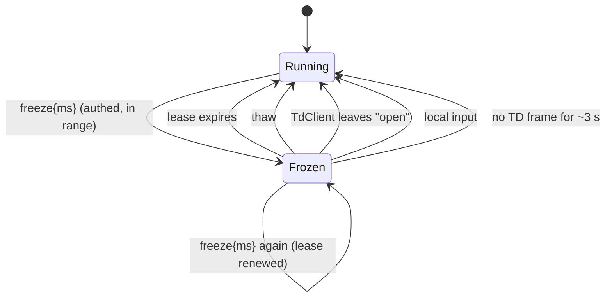

# Morphogen v2 — `freeze` limits review (TD → app)

_Design review, added 2026-11-07. Status: **still refused.** `parseTdCommand`
returns `null` for `{v:1, cmd:"freeze"}` today, and
`tests/tdCommandsDoc.test.mjs` asserts that. This page answers the question the
`src/sync/tdCommand.ts` header has carried since 2026-10-21 — "who un-freezes
the sim if TD drops?" — so the next implementation pass starts from agreed
rules instead of re-deriving them. No code changed with this note._

## Why `freeze` is different from `preset` and `setParams`

`preset` and `setParams` are **idempotent and self-healing**: if TD vanishes
mid-show, the Field keeps animating with the last numbers it was given, and the
performer can still move the sliders or step presets locally. Nothing is stuck.

`freeze` is the first command whose effect is **a missing thing** (no kernel
steps). If TD sends `freeze` and then the link dies, the browser shows a still
image indefinitely, and from the audience's side that is indistinguishable from
a crashed tab. So the review is mostly about the exits, not the entry.

## What the code already gives us (checked on `main` this run)

| Fact | Where | Why it matters for `freeze` |
| --- | --- | --- |
| A dropped authed socket goes `open` → `reconnecting` in `ws.onclose`, then retries with capped backoff (`RECONNECT_BASE_MS` 500, `RECONNECT_MAX_MS` 15 000, `RECONNECT_MAX_ATTEMPTS` 8). | `src/sync/tdClient.ts` | There is a single, reliable place to notice "TD is gone": the status leaving `open`. Reconnect can take tens of seconds, or give up entirely. |
| Every fresh ack resets the command gate, the tally and `tdRtt()`. | `tdClient.ts` (`onmessage` ack branch) | A freeze must not survive a reconnect either — a new session starts clean, same as the tally. |
| TD sends a `status` frame ≤ 1/s, only while a browser is authed (`StatusHeartbeat`, `status_tick`). | `td/morphogen_sync_callbacks.py` | The browser already receives a steady pulse from a healthy TD. A freeze can be tied to it without a new TD timer. |
| The sim loop is a single rAF chain with idempotent `start` / `stop`, and a restart resets the clock so stopped time is never replayed. | `src/app/loop.ts` | Un-freezing cannot cause a catch-up burst; resuming is cheap and safe. |
| Local input already calls `loop.start()` when the loop isn't running (canvas press, ENTER). | `src/main.ts` | A performer touch is a natural manual override. |

## Rules (proposed — the frame stays refused until these are implemented and tested)

1. **Freeze is a lease, never a latch.** Frame shape:
   `{v:1, cmd:"freeze", ms:<int>}` with `ms` in **[250, 10 000]**
   (proposed `MAX_FREEZE_MS` = 10 000). The browser pauses kernel steps (render
   keeps drawing the last field, Hum keeps its current tone) and **thaws on its
   own when the lease runs out**. TD that wants a longer hold re-sends `freeze`
   before expiry; each frame spends a gate token, so at ≤ 10/s and burst 5 this
   is cheap. Out-of-range, missing, non-integer or non-finite `ms` is
   **refused, not clamped** — the same reasoning as `setParams`: TD must never
   believe it holds a 60 s freeze the browser is running as 10 s.
2. **`thaw` is explicit.** `{v:1, cmd:"thaw"}` ends the lease at once. It is
   accepted even when no freeze is active (a no-op, still counts as `applied`)
   so TD can send it defensively on cue-stack resets.
3. **Leaving `open` thaws immediately.** Any `TdClient` status change away from
   `open` (socket close, ack timeout on a retry, `fail()`, `disconnect()`)
   cancels the lease **before** the reconnect is scheduled. A frozen screen
   must never outlive the session that froze it. This is the direct answer to
   "who un-freezes if TD drops?": the browser does, at the same moment it
   notices the drop, without waiting for backoff.
4. **A fresh ack never inherits a freeze.** Same rule as the gate and tally:
   a new session starts running.
5. **Local input wins.** A canvas press, ENTER, Reset, a preset step or a
   slider move thaws and cancels the lease. The performer in the room always
   outranks the remote peer. The status line says `thawed (local)` so the
   operator at TD can see why their hold ended.
6. **Silence thaws too (belt and braces).** If the session is still `open` but
   no TD frame of any kind arrived for `2 × status interval + 1 s` (≈ 3 s with
   the current 1 Hz heartbeat), thaw. This covers a TD that is wedged but has
   not closed its socket. It reuses `commandStats().lastAt`, which `TdClient`
   already updates on every authed frame.
7. **Visible state.** While frozen, the status line reads
   `frozen by TD · N s left` and the `#syncCmds` tally counts the frame as
   `applied`. `?debug=1` snapshot gains `freeze: {until, reason}`.
8. **No new trust.** Same parser, same size cap, same gate, authed sessions
   only, extra keys refused whole.

## Exit paths, in one picture

Every arrow out of `Frozen` is driven by the browser. None of them needs TD to
be alive.

## Order of work when this is picked up

Following the 2026-10-23 contract rule (fixture first, then both twins):

1. `tests/fixtures/td-commands.v1.json`: add `freeze_ms_range`, built
   `freeze` / `thaw` frames, builder rejects, and browser refusals (bare
   `freeze`, `ms` 0 / 249 / 10 001 / 1.5 / `"500"` / `null`, extra key).
   Remove the plain "freeze is refused" row only in the same change.
2. Browser: `parseTdCommand` cases; a small pure `createFreezeLease(now)`
   helper (start / renew / thaw / `remaining(now)`, NaN- and backwards-clock
   safe, like `createCommandGate`), unit-tested on its own; `main.ts` wires it
   to `loop.stop()` / `loop.start()` and to the `TdClient` status callback.
3. TD: `MAX_FREEZE_MS` / `MIN_FREEZE_MS`, `make_freeze_command(ms)`,
   `make_thaw_command()`, `send_freeze(dat, ms)` / `send_thaw(dat)`, new
   `freeze` row in `morphogen_cmds`.
4. Tests that must exist before the refusal is lifted: lease expiry; renewal;
   socket close while frozen thaws before reconnect; fresh ack starts running;
   local press thaws; silence timeout; out-of-range refused not clamped;
   `tdCommandsDoc` drift rows for the new limits.
5. Docs: `TD-COMMANDS.md` frame section, Limits rows and troubleshooting
   ("screen stopped" → check `#syncCmds` and the lease line); this page's
   status line flips to "implemented".

## Open questions (for whoever picks this up)

- Should a frozen field keep **rendering** (cheap, lets the HUD / Hum stay
  alive) or skip draws entirely to save battery on phones? Proposed: keep
  rendering; the cost is the canvas blit, not the kernel.
- Does Hum hold its tone or fade during a freeze? Proposed: hold. A fade is an
  artistic choice TD can make with a later command.
- Is 10 s the right ceiling? It is long enough for a dramatic hold and short
  enough that a lost renew is noticed within one musical phrase. Revisit after
  a live rehearsal.
