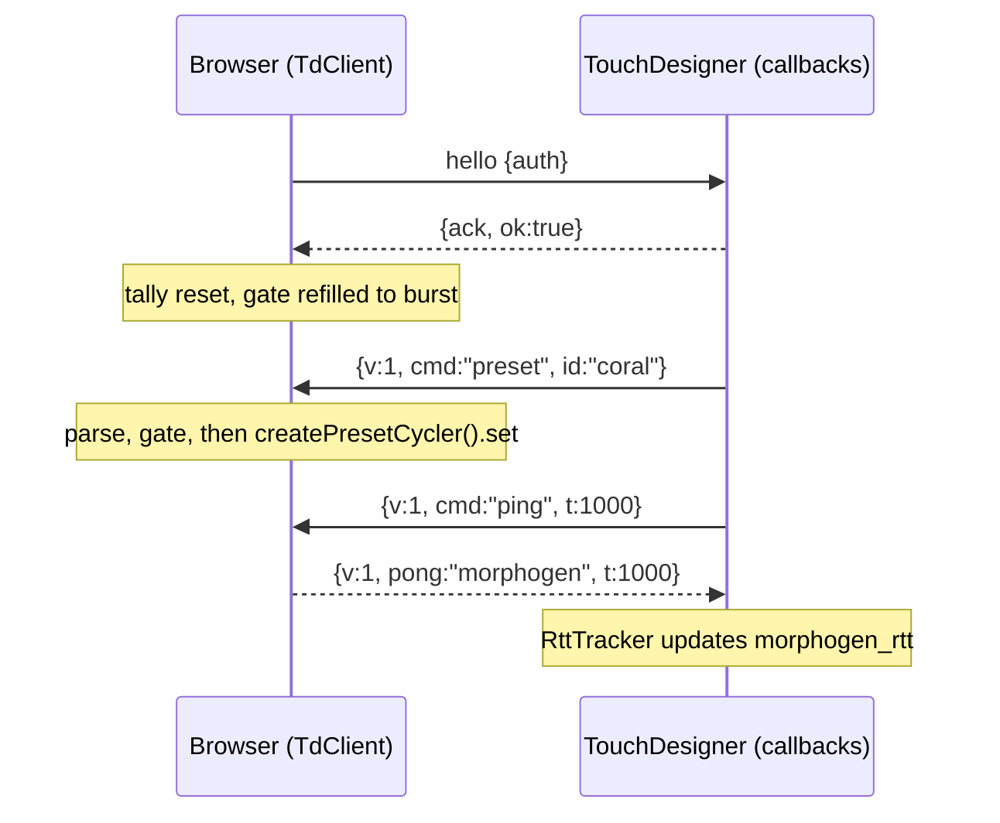

# Morphogen v2 — TD → app command channel (v1)

_Architecture + operator note, added 2026-10-27. One page that ties together the
pieces landed 2026-10-21 → 2026-10-26 (parser, TD helper, contract fixture, both
tallies, Sync panel chip). The code comments stay the source of truth; this page
is the map. `tests/tdCommandsDoc.test.mjs` fails if the numbers below drift from
`src/sync/tdCommand.ts` or the contract fixture._

## Who owns what

| Side | File | Role |
| --- | --- | --- |
| Browser | `morphogen-v2/src/sync/tdCommand.ts` | The only parser for inbound TD frames (`parseTdCommand`), the rate gate (`createCommandGate`), the pong shape (`pongFor`) and the tally line (`describeCommandStats`). Pure, no DOM. |
| Browser | `morphogen-v2/src/sync/tdClient.ts` | `handleCommand` routes each authed frame through parse → gate → ping/apply and counts it in `commandStats()`. |
| Browser | `morphogen-v2/src/ui/panels.ts` | `mountSyncCommandLine` shows the tally as the `#syncCmds` chip while the session is authed. |
| TD | `morphogen-v2/td/morphogen_sync_commands.py` | Frame builders (`make_preset_command`, `make_ping_command`), `CommandPacer` (same bucket as the browser), `RttTracker`, `SendStats` / `describe_send_stats`. |
| TD | `morphogen-v2/td/morphogen_sync_callbacks.py` | `send_preset(dat, id)` / `send_ping(dat)` broadcast to **authed clients only**; pongs go to `morphogen_rtt`, send tallies to `morphogen_cmds`, `send_stats_line()` prints one line. |
| Both | `morphogen-v2/tests/fixtures/td-commands.v1.json` | Golden contract: exact frame bytes, refusals, pong shape and gate verdicts. Read by the node suite and by pytest. |

## Lifecycle

Nothing is parsed as a command before the ack. A fresh ack (reconnect, new
session) resets the browser tally and refills the gate; TD resets `SendStats`
and its pacer when a new client authenticates.

## Frames

Accepted (v1):

- `{"v":1,"cmd":"preset","id":"coral"}` switches the Field preset. Ids are
  trimmed and lower-cased; an unknown but well-formed id parses fine and is a
  no-op in `createPresetCycler().set`.
- `{"v":1,"cmd":"ping","t":1000}` is answered by TdClient itself with
  `{"v":1,"pong":"morphogen","t":1000}`. A missing or non-finite `t` echoes as `null`.

Refused (parse returns `null`, frame dropped, session untouched):
`setParams` and `freeze` (reserved until they get their own limits review),
any `v` other than `1`, missing `cmd`, arrays, non-JSON, malformed preset ids,
and anything over the size cap.

## Limits

| Limit | Value | Constant (browser / TD) |
| --- | --- | --- |
| Max frame size | 512 B | `MAX_COMMAND_BYTES` |
| Max preset id length | 32 chars | `MAX_PRESET_ID_LEN` |
| Sustained command rate | 10 per second | `COMMAND_RATE_PER_S` |
| Burst | 5 frames | `COMMAND_BURST` |

The gate is a token bucket. A backwards or non-finite clock refills nothing, so
a bad timestamp can only make it stricter. Refused frames are counted **before**
the gate and do not spend a token; pings **do** pass through the gate.

## Reading the two tallies side by side

The browser counts what it **received** (`TD cmds: …`, in the `#syncCmds` chip
and the `?debug=1` snapshot as `tdCommands`). TD counts what it **tried to send**
(`TD sent: …` from `send_stats_line()`, rows in `morphogen_cmds`). Within one
session, `applied + pings + refused + paced === frames` on the browser side.

| What you see | Likely meaning | What to check |
| --- | --- | --- |
| TD `presets` matches browser `applied` | Healthy. | Nothing. |
| TD `with no authed client` grows, browser chip hidden | No authed browser: TD dropped the send locally. | `Syncsecret` on the TD COMP, the browser's Sync URL, the Sync chip state. |
| TD `paced` grows | TD's own pacer held the frame back; it never hit the wire. | Slow the cue stack or spread cues out. |
| Browser `paced` grows (chip turns amber) | Frames reached the browser faster than 10/s burst 5, so TD's pacer was bypassed or the clocks disagree. | Something sending without `send_preset` / `send_ping`; a second TD sender. |
| Browser `refused` grows | TD sent frames this build doesn't accept (reserved command, newer `v`, bad id). | TD script version vs. this contract; the fixture's `browser_refuses` list. |
| Browser `handler errors` > 0 | The preset handler threw; telemetry kept flowing. | Browser console, `main.ts` preset routing. |
| TD sent more pings than `morphogen_rtt` samples | Pongs lost or the session dropped mid-ping. | Network, reconnect count in the Sync chip. |

## Changing the contract

1. Edit the rule on **both** sides (`tdCommand.ts` and `morphogen_sync_commands.py`).
2. Update `tests/fixtures/td-commands.v1.json` (bump `version` and the file name
   for a wire-breaking change).
3. Update the Limits table above if a number moved.
4. Run `npm test` in `morphogen-v2/` and the TD pytest suite; both must pass.
